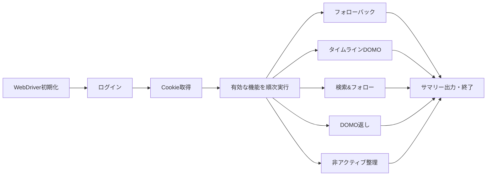

# YAMAP Auto DOMO

[YAMAP](https://yamap.com) 上の定型作業(フォローバック、タイムラインへの DOMO、検索からのフォロー、DOMO返し、非アクティブユーザーの整理)を、Selenium(Headless Chrome)で自動化する Python スクリプトです。動作は `yamap_auto/config.yaml` と環境変数で制御します。

> [!WARNING]
> 非公式の個人ツールです。利用は自己責任で、YAMAP の利用規約を必ず確認してください。詳細は「[注意事項](#注意事項)」を参照してください。

## 特長

- **ログイン**: 環境変数の認証情報で YAMAP に自動ログイン
- **フォローバック**: 自分をフォローしたユーザーをフォローバック
- **タイムライン DOMO**: タイムライン上の活動記録へ DOMO
- **検索&フォロー**: 活動記録の検索結果を巡回し、フォロワー数・フォロー/フォロワー比率の条件を満たすユーザーをフォローして DOMO
- **DOMO返し**: 自分の過去記事に DOMO したユーザーの最新記事へ DOMO(条件付きでフォローも)
- **非アクティブユーザー整理**: 一定期間活動がなく、かつフォローバックされていないユーザーのフォローを解除
- **機能ごとの ON/OFF、並列処理、待機時間、上限数** を設定ファイルで調整可能
- 実行後に件数サマリーをログ出力

## 技術スタック

| 区分 | 内容 |
| --- | --- |
| 言語 | Python 3 |
| ブラウザ操作 | Selenium WebDriver(Chrome / ChromeDriver) |
| 設定 | PyYAML |
| HTML解析 | BeautifulSoup4 |
| 補助 | Playwright(`yamap_auto2/` の実験的ログイン確認スクリプトのみ。requirements.txt には含まれません) |

## 動作要件

- Python 3.8 以上
- Google Chrome と、そのバージョンに合う ChromeDriver(PATH に配置、または `config.yaml` の `chromedriver_path` で指定)
- YAMAP アカウント

## セットアップ

```bash
git clone <このリポジトリのURL>
cd yamap-auto-domo
pip install -r requirements.txt
```

1. 環境変数を設定します(名前のみ記載。値は各自で設定してください)。
   - `YAMAP_LOGIN_ID`: ログイン用メールアドレス
   - `YAMAP_LOGIN_PASSWORD`: ログイン用パスワード
   - `YAMAP_USER_ID`: 自分の YAMAP ユーザーID(`yamap_auto_domo.py` が参照)
   - `USER_ID`: 同じく自分のユーザーID(`driver_utils.py` の `get_credentials` が参照)
   - `YAMAP_CONFIG_FILE`(任意): 設定ファイルのパスを上書き
2. `yamap_auto/config.yaml` を編集して、有効にする機能と上限を決めます。

## 使い方

```bash
python -m yamap_auto.yamap_auto_domo
# または
python yamap_auto/yamap_auto_domo.py
```

Windows 用の `run_yamap.bat` も同梱していますが、環境変数の設定部分は自分の環境に合わせて書き換えてください(認証情報を直接書いてコミットしないこと)。

### 処理の流れ



### Cloud Functions 用エントリポイント

`main.py` に Google Cloud Functions 向けの `handler(event, context)` があり、`yamap_auto_domo.main()` を呼び出します(デプロイ設定は同梱していません)。

## 設定(`yamap_auto/config.yaml`)

| キー | 内容 |
| --- | --- |
| `enable_follow_back` / `enable_timeline_domo` / `enable_search_and_follow` / `enable_domo_back_to_past_users` / `enable_unfollow_inactive` | 各機能の ON/OFF |
| `enable_parallel_processing`, `parallel_processing_settings` | 並列処理(`max_workers`, `use_cookie_sharing`, 遅延) |
| `headless_mode`, `implicit_wait_sec` | ブラウザ表示・暗黙待機 |
| `webdriver_settings` | `execution_environment`(`local` / `docker_container`), `chromedriver_path`, `chrome_binary_location`, `user_agent` |
| `action_delays` | DOMO/フォロー後などの待機秒数 |
| `follow_back_settings` | フォローバック上限、確認ページ数、並列設定 |
| `timeline_domo_settings` | タイムラインで DOMO する最大件数 |
| `search_and_follow_settings` | 検索URL、処理ページ数、最小フォロワー数、フォロー比率閾値 など |
| `new_feature_domo_back_to_past_domo_users` | DOMO返しの対象期間・件数・フォロー有無 |
| `unfollow_inactive_users_settings` | 非アクティブ判定日数、1回の最大解除数、フォローバック確認 |

> [!NOTE]
> 同梱の `config.yaml` は `execution_environment: "docker_container"` で、並列ワーカー数も大きめ(24)です。ローカル実行時は `local` に変更し、ワーカー数は 2〜5 程度から試してください(設定ファイル内のコメントも同様の推奨です)。

## 構成

```
.
├── main.py                    # Cloud Functions エントリポイント
├── yamap_auto/
│   ├── yamap_auto_domo.py     # メイン(ログイン〜各機能の実行〜サマリー)
│   ├── config.yaml            # 動作設定
│   ├── driver_utils.py        # WebDriver・設定・認証情報の読み込み
│   ├── follow_back_utils.py / follow_utils.py / unfollow_utils.py
│   ├── domo_utils.py / search_utils.py / my_post_interaction_utils.py
│   ├── user_profile_utils.py
│   └── logging_utils.py
├── yamap_auto2/               # Playwright によるログイン確認の実験コード
├── debug_domo_finder.py / debug_emoji_click.py  # デバッグ用
├── docs/debugging_guide.md
├── requirements.txt
└── run_yamap.bat
```

## 制限事項

- Dockerfile / docker-compose は同梱していません。
- YAMAP のサイト構造変更により、セレクタ修正が必要になる場合があります(`NoSuchElementException` / `TimeoutException` が出た場合)。
- 自動テストはありません。

## 注意事項

- 本ツールは YAMAP の公式ツールではありません。自動操作は **YAMAP の利用規約に抵触する可能性** があります。最新の規約を確認し、**自己責任** で使用してください。
- 本ツールの使用により生じたいかなる損害(アカウント制限・停止を含む)についても、作者は責任を負いません。
- 並列数や実行頻度を高くしすぎると、サーバー負荷やアカウント制限のリスクが高まります。**過度な頻度での実行は避けて** ください。
- 認証情報は環境変数などで管理し、リポジトリにコミットしないでください。
